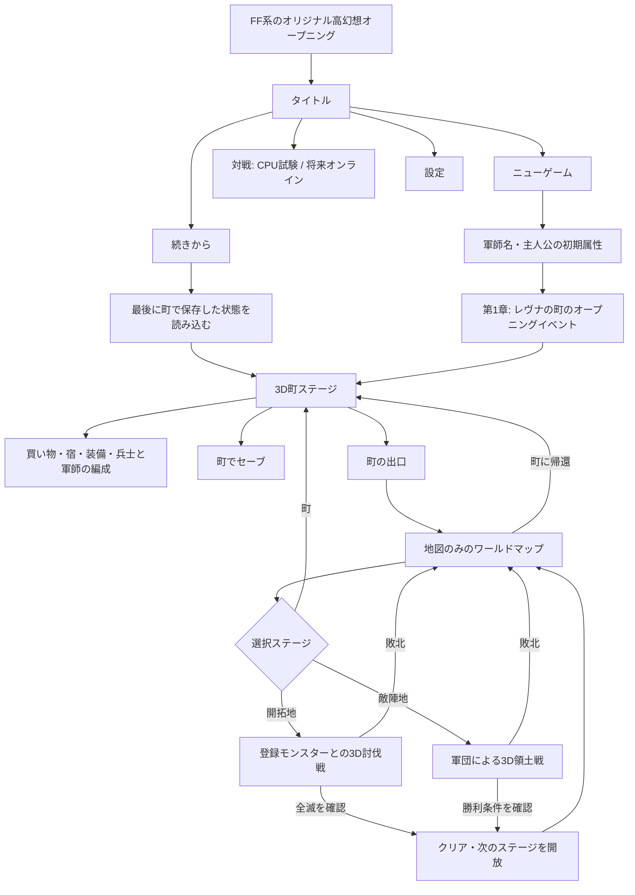

# 灰銀戦記 ― 沈黙の星鐘 / ゲーム母体・20章×10ステージ設計

更新: 2026-11-10。既存の `story-campaign.js`・20章ナレーション・3D軍団戦を維持しつつ、ゲームの導線と進行データを分離する。

## ゲームの基本導線

非戦闘のゲーム操作は「町＝3D探索＋メニュー」「ワールド＝地図＋選択」という二つのUIを標準とする。地図は編成・物品購入・財務管理画面を持たない。町の外を押してから地図に遷移する。

## 20章×10ステージ

- IDは `c01-s01` ... `c20-s10` で固定。総数200。
- 各章01は「町・オープニング/拠点イベント」。章1はレヴナ、後続は地域拠点。これらはすべて町ステージとして管理。
- 各章02,04,06,08は「開拓地・出現モンスターの全滅」。既存50体モンスター図鑑から種族IDを参照。
- 各章03,07は「陣地制圧」。章ごとの戦闘パターンを設定。
- 各章05は「拠点防衛」または次の戦線に向けた陣地任務。
- 各章09は「攻城戦」。
- 各章10は「章の決戦」。勝利で次章の町が解放される。
- 各ステージの種別・地形・シーンプリセット・敵勢力・勝利条件・解放条件を `src/campaign-stage-plan.js` に集約。
- 既存の3Dステージ素材／敵モデルを再利用する初期スキーマ。200通りの地形・建物・イベント・敵配置を個別制作した状態と混同しない。

## UIの画面規則

1. 画面スクロールは禁止。ページサイズに合う固定パネルを使用。
2. 内容量が超える商店・軍編成は `◀/▶` ページボタンで切り替え、スライダー・スクロール依存をなくす。
3. 地図の移動はタップ＋`◀ 地図 / 中央 / 地図 ▶`。モバイルでは自動縮小か左右移動を使用。
4. 3D町の移動・会話・家への入退室は既存アクションゲームの操作UIを再利用。トップバーは町のメニュー。
5. 戦闘中は既存の3D戦闘UIと号令を維持し、町のメニューや地図のボタンを重ねない。
6. 画面はスマートフォン縦向き・横向き両方に対応し、狭い縦画面でも縦スクロールを出さない。今後は実機のタッチ当たり判定を確認する。

## セーブの責務

- `GAME_SAVE_KEY=hai-gin-core-slot-1` は `saveAtTown` 経由でのみ `localStorage` に書く。
- 戦闘・地図中は `sessionStorage` に一時状態を保存。タブを閉じる・新しくロードすると未保存分は失われる。
- 続きからは最後の町セーブをロードし、町に復帰。タイトルから直接地図へ入る経路はない。
- 旧 `hai-gin-story-campaign-v1` を読んだ場合は軍師・兵士・領地状態を移行するが、旧セーブの削除・上書きは行わない。
- 戦死者数や討伐勝利は戦闘結果の検証後のみ反映。同一 battleId の二重清算禁止。
- `wallet` は町の個人物品購入、`campaign.treasury` は傭兵雇用・国家運用で別会計。

## 戦闘接続

- `src/core-battle-bridge.js` はゲーム側のステージ進行と既存戦闘を接続する。
- 討伐戦は `enemyMode:'monsters'`、敵IDは図鑑登録済み `MONSTER_CATALOG` を使用。3Dモデルは `createMonsterModel` を使用。
- 討伐のクリア判定は敵軍全滅＋ `monstersRemaining===0`。退避や途中敗北では完了にしない。
- 領土戦は `enemyMode:'army'`。現在の勝利判定は既存の部隊勝敗に接続している。
- 陣地制圧の占領ポイント・維持時間・城門など「勝利条件の個別判定」は今後の戦闘AI／ステージ作業。現在は単に軍団戦の勝利をもってステージが進む暫定接続であり、正式な旗奪取条件ではない。
- 戦闘後は `world-map.html` に戻す。敗北した場合も損失は反映するが解放ステージは進まない。
- `story-campaign.js` の既存領土12区画と200ステージ内の「小陣地」は別の層。小陣地は `capturedAreas` で記録し、従来の12区画を無断で一括塗り替えない。

## 実装ファイル

| 場所 | 役割 |
|---|---|
| `index.html` | ゲームの入口（タイトルへ） |
| `game.html` | オープニング・タイトル・ニューゲーム・続きから・対戦入口・設定 |
| `town-hub.html` | 旧アクション町3Dを再利用、ショップ、装備、軍団編成、町セーブ |
| `world-map.html` | 地図と20章×10ステージのみのUI |
| `src/campaign-stage-plan.js` | 200ステージ台帳 |
| `src/game-core-flow.js` | 状態遷移、町セーブ、旧データ移行、商店 |
| `src/core-battle-bridge.js` | 3D軍団戦・魔物戦出撃と帰還結果 |
| `tactics-wireframe.html` | 既存の3Dリアルタイム軍団戦と魔物3Dモデル |
| `dev-menu.html` | 旧テストメニューを退避 |
| `qa/game-core-contract.test.mjs` | 一連のゲーム母体回帰テスト |

## 追加の制作タスク

**優先1（動線品質）**：実機で画面遷移・ボタン当たり判定・Android縦持ち無スクロール検証、3D町の頭上UIと町メニューの被り対策、戦闘中の戻り経路の再接続、セーブ継続テスト。

**優先2（RPGの手触り）**：町NPCをタップして該当施設を開く、武器防具アイテムが実際のステータスへ反映する、宿・教会・酒場、兵士/軍師の手動編成、部隊ごとの買い物とアイテム使用。

**優先3（本格攻略）**：占領フラッグ・制圧ゲージ・陣地防衛タイマー・城門の勝敗判定、敵軍の出撃位置と陣地AI、200ステージ固有の目的・報酬・NPC・シナリオイベントを実装。

**優先4（演出）**：商用利用できるオリジナル高幻想OP映像/BGM、収録済みVOICEVOXの再生タイミング最適化、20章イベントを町内・町外のカットシーンで表示。既存ゲーム・楽曲・キャラクターの直接流用はしない。

**優先5（対戦）**：CPU模擬戦と通信対戦を分離し、オンライン対戦は同期方式・チート防止・マッチング・切断復旧を独立設計。現時点では通信対戦を実装済みと表示しない。

## 自動テスト

`node --experimental-vm-modules qa/game-core-contract.test.mjs` をCIとPages公開前に実行。既存の`qa/story-chronicle.test.mjs`は維持。ここに追加するシナリオは、保存前後のロールバック、500回以上の遷移、Android viewport画面比較、画面内スクロール排除、3D戦闘ロード試験。
