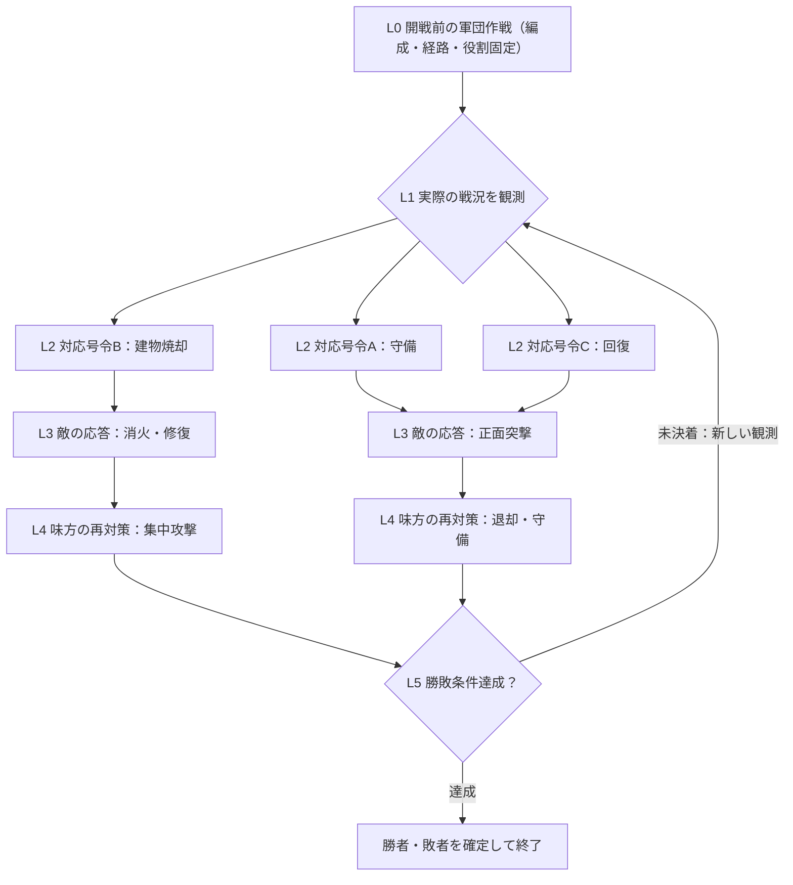

# 灰銀のレゾナンス：作戦・戦況・対応策・再対応策 階層仕様 v1.0

> 分類：**ゲームデザインの確定基準／データ仕様**。この文書および `src/battle-strategy-countertree-spec.js` は対策階層の仕様と参照グラフであり、敵AIが全分岐を実行済みであるという意味ではない。現時点では後続ドラフトPR上で検証する。

## 1. 目的と責務の切り分け

プレイヤーは開戦前に**複数隊の軍団作戦**を1つ選ぶ。作戦には編成・各隊の役割・高低差・利用施設・進軍ルート・代替ルート・勝利目的が含まれる。戦闘は常にリアルタイムで進み、敵も味方も作戦による状況を作り出す。

- **作戦（軍団・L0）**：複数隊が連動して実行する長期方針。進路、橋、階段、屋上、屋内、飛行召喚獣の着地点はここで定義し、戦闘中の個別号令から**再指定しない**。
- **戦況（L1）**：位置、HP/MP、敵の号令、占拠、建物、天候など実際に確認できる観測イベント。既存の **67状況**をすべて階層に参照する。作戦から必ず発生すると決めつけず、予測候補として保持する。
- **対応策（L2）**：戦況に対して味方が選択できる複数の対応号令。既存の突撃・守備・待機・退却、ジョブ依存の建物破壊・解錠・修復・回復などから対象と実行条件が揃うものを選ぶ。
- **敵の対策（L3）**：L2に対する敵の応答候補。既存の4種の敵AI号令と、将来的なジョブ依存任務を区別する。敵の非公開の選択は透視しない。
- **味方の再対策（L4）**：L3で実際に確認した変化への追加対応。ここでも部隊・ジョブ・対象・待機時間を再検証する。1回の押下でL2～L4を一括実行しない。
- **再観測／決着（L5）**：新しい状況を検出したら L1 に戻り、勝敗条件を満たしたら終了。相手が永遠に対策を返す仮想ループを処理し続けない。

**最優先の不変条件：いずれの作戦・号令でも、勝利は「固有目標の達成 または相手軍の殲滅」から変化しない。** 攻撃側と防衛側は反対の固有目標を持ち、勝敗は `evaluateBattleObjective` が一元判定する。同時全滅時の既存の防衛側優先ルールも維持する。

## 2. 階層構造（L0～L5）



上記のA・B・Cは図解であり、1戦況に3択という制限はない。各 L2 対応には**L3の対策候補を最低2つ**、各 L3 には**L4の再対策候補を最低2つ**定義する。現実の戦闘では選ばれなかった分岐は実行せず、世界の変化が起きた時点で再評価する。作戦の移動ルートは対抗号令の分岐から生成しない。

### 枝の役割と発令者

| 層 | 決めるもの | 担当 | 実行条件 |
|---|---|---|---|
| L0 | 軍団作戦、複数隊の配置、進軍路・代替路、勝利目的 | 開戦前のプレイヤー／敵の作戦AI | ステージ地形・職業編成・2隊以上が必要な連携作戦 |
| L1 | 状況の観測、脅威・優先度 | 戦況監視 | 実世界の座標・HP・状態・施設・明示的イベント |
| L2 | 対応策候補から1件を選択 | プレイヤーと味方軍師 | 軍師生存、ジョブ・射程・MP・標的生存、号令間隔 |
| L3 | 敵の対応策 | 敵AI（実装済み4号令／高度な特殊任務は段階実装） | 敵の可視情報と敵自身の実行条件 |
| L4 | 敵の応答に対する再対策 | 味方プレイヤー／軍師 | L2と同じ検証を実施。待機中は自動作戦を維持 |
| L5 | 決着判定、新たな戦況生成 | 戦闘エンジン | 勝敗が未決着なら最も重要なL1へ戻る |

## 3. 12作戦をルートにした代表的な分岐

以下は **L0 → L1 → L2 → L3 → L4** の順。表に出した4～5手は「可能な分岐例」であり、相手が必ず同じ行動を取るスクリプトではない。**実際の全分岐は機械可読なグラフに収録**し、別冊の67状況マトリクスと紐付ける。

| L0：軍団作戦 | L1：発生状況 | L2：味方の対応策 | L3：敵の対策 | L4：味方の再対策 |
|---|---|---|---|---|
| 基本迎撃 | 敵軍が一斉突撃 | 盾隊が守備 | 敵が再突撃 | 僧侶隊で回復／集中攻撃 |
| 基本迎撃 | 敵が守備陣を形成 | 前衛が突撃 | 敵が退却 | 敵部隊を集中攻撃 |
| 堅陣防衛 | 敵が防衛拠点へ進入 | 盾隊が守備 | 敵魔法隊が施設を焼却 | 魔法隊が消火／前衛が退却 |
| 堅陣防衛 | 防衛隊に損耗が蓄積 | 回復要請 | 敵が僧侶隊を集中攻撃 | 盾隊が守備／回復隊を保護 |
| 高地射撃 | 敵が塔の高所から攻撃 | 前衛が守備 | 敵魔法隊が遮蔽物を焼却 | 消火または退却 |
| 高地射撃 | 屋上で味方が孤立 | 飛空召喚獣で救助 **※未実装** | 敵が救助中の隊を狙う | 守備・退却 |
| 破城工作 | 敵の門が施錠 | 盗賊隊が解錠 | 敵が再施錠 | 魔法で建物を焼却／忍者で障害物破壊 |
| 破城工作 | 城内に敵が籠城 | 魔法隊が建物焼却 | 敵が消火 | 消火係を集中攻撃 |
| 橋破壊・封鎖 | 敵の渡河橋を確認 | 忍者隊が橋破壊 | 敵が橋を修理 | 修理隊を集中攻撃／守備 |
| 橋破壊・封鎖 | 敵が橋を封鎖 | 忍者隊が障害物破壊 | 敵が修復 | 前衛の突撃 |
| 目標強襲 | 敵陣制圧の残り時間が少ない | 機動隊が突撃 | 敵が守備 | 敵部隊集中攻撃／魔法で建物を焼却 |
| 目標強襲 | 制圧区域を敵が争う | 敵部隊を集中攻撃 | 敵が後退 | 待機して確保 |
| 波状攻撃 | 前衛隊に集中攻撃 | 僧侶が回復 | 敵が僧侶を狙う | 別の前衛隊で守備 |
| 波状攻撃 | 突撃隊が壊滅寸前 | 退却 | 敵が追撃 | 予備隊で守備 |
| 城門死守 | 味方の門を攻撃 | 盗賊が施錠強化 | 敵盗賊が解錠 | 敵部隊を集中攻撃／再施錠 |
| 城門死守 | 味方建物が炎上 | 魔法隊が消火 | 敵が再点火 | 防衛隊が火元を守備／集中攻撃 |
| 魔法弾幕 | 敵魔法使いが詠唱 | 盾隊が守備 | 敵が再突撃 | 回復支援 |
| 魔法弾幕 | 敵飛空召喚獣が突入 | 飛行敵を集中攻撃 | 敵が防御 | 前衛が突撃 |
| 主将狙撃 | 敵軍師を発見 | 忍者隊で敵軍師討伐 | 敵軍師が退却 | 敵部隊を集中攻撃 |
| 主将狙撃 | 敵が兵力劣勢で後退 | 前衛が突撃 | 敵がさらに退却 | 標的部隊を集中攻撃 |
| 侵入・解錠 | 敵の城門に鍵 | 盗賊隊が解錠 | 敵盗賊が再施錠 | 魔法で焼却／忍者で破壊 |
| 侵入・解錠 | 敵忍者が背後に侵入 | 守備 | 敵が再突撃 | 標的部隊を集中攻撃 |
| 殿軍・支援 | 屋上で味方が孤立 | 回復要請 | 敵が回復隊を狙う | 盾騎士隊で守備 |
| 殿軍・支援 | 騎乗者が落下・負傷 | 回復要請 | 敵が負傷者へ突撃 | 前衛が守備 |

### 特に重要な分岐：屋上・建物破壊・召喚獣

```text
作戦：高地射撃（味方弓隊は屋上、盾隊は階段、僧侶隊は後方）
 ├─ 状況：敵が屋根から反撃
 │   ├─ 対応A：盾騎士「守備」
 │   │   ├─ 敵：正面突撃 → 再対応：待機／回復／集中攻撃
 │   │   └─ 敵：建物焼却 → 再対応：消火／退却
 │   ├─ 対応B：忍者「突撃」
 │   │   ├─ 敵：高所の守備強化 → 再対応：集中攻撃
 │   │   └─ 敵：撤退 → 再対応：味方屋上隊の維持
 │   └─ 対応C：召喚獣「高所救助」【仕様のみ・未実装】
 │       ├─ 敵：救助先を集中攻撃 → 再対応：守備／退却
 │       └─ 敵：着地点へ突撃 → 再対応：守備／空中迎撃【一部未実装】
 └─ 新しい戦況・実際の敵応答を検出 → 再評価
```

建物焼却は**実在する敵建物があり魔法使いが実行可能な場合だけ**候補となる。飛行召喚獣の屋上への既存の騎乗・移動機能はあるが、他隊の兵士を乗せて運ぶ「救助・輸送」は専用の状態遷移・同乗・着地点安全判定が必要なので未実装とする。移動経路を号令で新しく作らず、作戦で選ばれた屋上ルート・着地点を使用する。

## 4. 状況の全件統合

登録済みの **12軍団作戦 → 67状況 → 20種類の号令候補 → 敵の応答 → 味方の再対応** を `src/battle-strategy-countertree-spec.js` で関連付ける。

8カテゴリの内訳：勝利条件10／敵行動16／地形11／オブジェクト8／戦力12／視界4／状態異常4／終戦2。全67状況は最低1つ以上の軍団作戦に紐付け、複数の作戦で共通して発生する状況（軍師戦死・落下・負傷・敵突撃など）は参照共有とする。詳細な67状況の個別定義は `docs/battle-situation-countermeasure-matrix.md` を参照する。

- **L1で対象が観測されたときだけ**その状況を現役にする。予測や敵の非公開作戦を観測したことにしない。
- L2では各状況が持つ**全対応候補**を参照し、軍師の生存、職業、対象、MP、射程、衝突などを満たすものを利用可能にする。
- L3/L4には各L2に対し**2種類以上の敵応答候補と、その各枝に2種類以上の味方再対応候補**を登録する。実行可能性は各枝で再検査する。
- 「未実装」の飛行救助・空中先駆け・空中迎撃・屋上救出は表示のみで**押せない**。
- L3の特殊任務（建物消火、修理、解錠等）は**将来の敵AI仕様の候補**。敵AIが現在自動的に全て使用するという意味ではない。

## 5. 判定・優先・選択アルゴリズム

1. **世界状態を取得**：戦闘開始時に固定した軍団作戦、実際の各隊HP/MP、ジョブ、戦況イベント、軍師状態、建物・橋・門の座標/HP、占拠・時限ルール、残り時間を参照。
2. **まず勝敗を判定**：固有目標の達成または敵軍殲滅が成立したら即決着。共倒れの扱いは既存規則を使用。
3. **L1の状況を活性化**：存在が検証済みの観測信号だけで発火する。まだ未接続の煙・天候・凍結などは発火しない（イベント提供後に追加）。
4. **緊急度を決定**：①直近の勝敗（占拠・残り時間）②不可逆な味方崩壊／軍師危機 ③敵の高威力攻撃・拠点崩壊 ④施設機会損失 ⑤追撃や支援 ⑥通常態勢維持。複数同時なら最重要の状況を最上位にする。
5. **L2候補を評価**：使える部隊が存在し、対象が有効で、元の作戦ルートから任務を遂行可能で、号令制限に抵触しない場合のみ押下可能。安全でない味方を巻き込む橋破壊や崩落は候補から除く。
6. **予想されるL3を提示**：敵の行動パターンや可能な対策を「予測」として表示する。実行を強制しない。敵が実際に動いたら、事前予測ではなく新しい実測の状況を反映する。
7. **L2を発令**：ユーザーが**一度選択して確定したときだけ**号令回数を加算。実行失敗・キャンセルは加算しない。号令対象は選ばれた部隊単位。
8. **自動作戦は続行**：L2/L4発令の待機中も他隊はL0の作戦に従い移動・攻撃・回復を実行する。
9. **L3を観測しL4を再評価**：敵がL2に対抗して行動したら、該当するL4候補を再評価する。制限時間内に再号令できなければ自動作戦が受け止める。
10. **L5に戻る**：終戦なら確定、それ以外は新しいL1イベントへ。L3/L4の候補探索は実際の時間を進めず、ターン制の待機処理は作らない。

### 号令の逓増間隔

| 味方軍全体での確定発令 | 次に人間が発令できるまで |
|---|---:|
| 第1回 | 60秒 |
| 第2回 | 90秒 |
| 第3回 | 120秒 |
| 第4回 | 150秒 |
| 第5回以降 | 180秒（上限） |

戦闘シミュレーション時間を使用。別隊への切替ではリセットしない。自動作戦・自動アイテム・敵AI発令は**味方プレイヤーの発令回数を増やさない**。道具は別の既存隊別使用制限を持つ。敵軍の高度な号令と累進待機時間の完全対称化は**今後の敵AI実装課題**であり、現行敵AIの120秒ベースのロジックが既に置き換わったとは主張しない。

## 6. ルートはあくまで作戦が決定する

- 階段、橋、窓、屋根、城門、川の渡河、崖の迂回、召喚獣の着地点は **L0** の作戦定義・ステージ経路BOMによって決める。
- L2やL4で選べる号令は **敵を攻撃／守備／撤退／待機／既存対象の破壊・修復・支援**。ルートの新設・選択UIは提供しない。
- 橋が壊れたり建物が崩れたりした場合は、**開戦前に用意していた代替経路があれば自動利用**、なければ安全な守備・待機へ移行して状況警告を出す。勝手なワープ・床貫通は行わない。代替経路の定義と有効性は実装側で改めて検証が必要。
- 号令によって構造物の地形が変わるのは許容する。**地形が変わること**と**作戦ルートを作り直すこと**は区別する。
- 忍者の鉤縄と飛行召喚獣の着地も「作戦で選択済みの経路・着地点」を使用する。救助・先駆けの専用AI未完成なら入力は無効。

## 7. データ構造・実装境界

データ参照：`src/battle-strategy-countertree-spec.js`

```text
TacticRoot {
  tacticId, title, routeAuthority: "prebattle_strategy",
  minSquads, squadRolesBoundBeforeBattle,
  situationBranches: [
    Situation {
      id, title, category, observableSignal, probability,
      allyResponseChoices: [
        AllyResponse {
          actionId, channel, requiredJobs, targetType,
          engineStatus, routeEditAllowed: false,
          opponentReplies: [
            EnemyReply {
              actionId, condition, hypothetical: true,
              enemyAiReady, // 基本4号令のみ既存AI経路を保証
              counterCounterOptions: [
                AllyCounterCounter {
                  actionId, engineStatus, routeEditAllowed: false,
                  after: "reobserve_or_adjudicate"
                }
              ]
            }
          ]
        }
      ]
    }
  ]
}
```

**ランタイムの責任を区別**する：

- `battle-stage-objective.js`：勝敗決定。作戦ツリーがこの結果を上書きすることは絶対にない。
- `battle-tactics-preset-policy.js`：L0 作戦・ジョブ・進軍ルート。開戦後の再編集禁止。
- `battle-countermeasure-situation-matrix.js`：67状況／20対応策／ジョブと有効標的の判定。実戦画面に接続済みの部分を利用。
- `battle-reactive-command-policy.js`：号令待機60→90→120→150→180秒と戦況観測。
- `battle-strategy-countertree-spec.js`：L0→L5の**仕様参照グラフ**。敵AIの全分岐自動制御・経路補正・同時状況最適化を新規実装したものではない。

## 8. 敵も味方も同じルールで行動するための制約

相手の「隠し作戦」「秘密の残MP」「未来の命令」を読まない。L3は**観測可能な事象**に基づいて推定し、敵AI側も職業・対象・MP・射程・ステージ制約を検証する。相手がそのジョブや対象を持たなければ候補を除外する。反応は「確率で必ず行う」ものではなく、AIが現状を評価して決定する枝の候補である。

失敗する号令は発令回数を消費しない。軍師がいない部隊は手動で発令できない。複数L1が同時に成立する場合も、プレイヤーにはその時点で選べる上位の対応候補を表示し、戦闘は止めず（号令選択中の既存の停止仕様の範囲でのみ一時停止）、指定を無理やり連続実行しない。

## 9. QA・受け入れ基準

1. **12の作戦すべてにL0ルートがあり、既存67戦況を100%参照できる**。未知の戦況ID／対応IDはテスト失敗。
2. L1の各状況に最低1つのL2対応。**L2に最低2つのL3敵対策、L3に最低2つのL4味方再対策**。参照のない孤立枝を作らない。
3. ジョブが足りない、標的がない、軍師死亡、MP不足、未実装召喚獣AI、再号令待機中などの入力は無効化。対象が動いたら再判定。
4. L2/L3/L4のいずれにも「移動ルートを編集する」アクションが存在しない。
5. 誰が勝ったかはステージ勝敗判定のみで決まる。攻城、防衛、制圧、殲滅の全モードで「固有目標 または 殲滅」が不変。
6. 既存の1000対1000用Worker・50対50・戦闘UI・ジョブ別編成を損なわない。**画面を使ったE2E、敵AIの複合対応、飛空召喚獣救助は別途実装と実機検証が必要**。
7. L4まで展開したら毎回L1再観測。隠されたターン待ち、無限再帰、1指示で複数の発令回数加算を起こさない。

## 10. 今後の実装順序

1. 現在のドラフトPR群の依存順に、**勝敗と編成 → 作戦選択 → 対抗号令 → 67戦況マトリクス**をレビュー・統合。
2. L3の敵AI専用分岐、状態異常・視界のイベント供給、作戦ルートの事前代替経路を追加。
3. L4での味方再対策推薦をゲーム画面に接続。発令間隔と軍師生存を毎回検証。
4. 飛空召喚獣の**救助・乗降・着地判定・独立先駆け・空中迎撃**の専用処理を実装し、QAを完了するまでボタン無効を維持。
5. 50対50と1000対1000で、複数の敵行動と再対抗が同時発生するケースを映像E2E・決着テストで確認してからデプロイ。

既存の元一覧：`docs/battle-situation-countermeasure-matrix.md`。本仕様を階層として機械検証するコード：`qa/battle-strategy-countertree-spec.test.mjs`。
