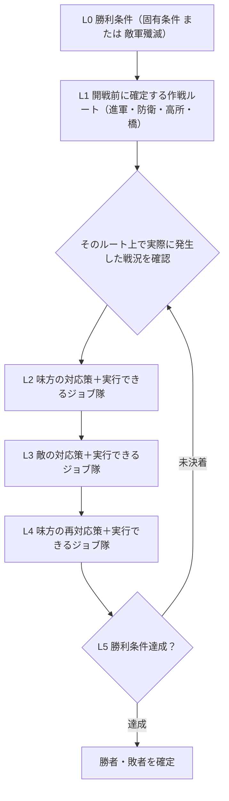

# 灰銀のレゾナンス：勝利条件 → ルート → 3段階の対応仕様 v2.0

> この文書が新しい**正規の階層仕様**です。以前の「作戦 → 戦況 → 対応…」の説明は補助資料に格下げします。勝利条件を最上位、事前に選んだ実在経路を二段目として、そのルートで起こり得る状況を受けて対応・反対応・再対応を展開します。これは**仕様グラフであり、すべての経路・敵AIが実装済みという意味ではありません**。

## 1. 変更後の正式な階層

**重要：** 67種類の「戦況」は階層の追加段数ではなく、**L1ルートに付属する発火条件（trigger）**として扱います。したがってプレイヤーが読む順は「勝利条件 → ルート → 味方対応 → 敵対応 → 味方再対応」です。敵の対応は例示された可能性であり、敵AIに強制するイベントではありません。

**役割と勝敗**：敵軍殲滅は全モードで代替勝利条件。攻城戦の主将討伐も既存の勝利条件を保持。防衛・制圧の規定秒数はステージごとに評価し、`evaluateBattleObjective` で一元判定します。敵側の勝利条件を起点としたときも、L2はプレイヤー味方側の対処、L3は敵側の返し手です。

## 2. 勝利条件ごとに選択できるルートと対応の連鎖

勝利条件の8分岐（4モード×味方／敵視点）を起点とし、各分岐に**4つの作戦ルート候補**を紐付けます。ルートとは現在の地形・通行可能セル・階段・橋などで**実際に成立する場合にのみ選択可能な設計テンプレート**で、ゲーム中の特定座標を勝手に捏造するものではありません。

### 敵軍殲滅・味方

**勝利条件**：敵軍を全滅させる

| L1：作戦ルート | ルートに必要な部隊（ジョブ） | 発生する戦況（例） | L2：味方の対応（担当隊） | L3：敵の対応（担当隊） | L4：味方の再対応（担当隊） |
|---|---|---|---|---|---|
| **中央正面突破路** (`center_push`) | 剣士／槍兵／格闘家隊 ＋ 盾騎士隊 ＋ 弓兵／魔法使い隊 ＋ 僧侶隊 | 敵の全軍突撃・進軍 | **🛡 守備**（味方：全ジョブ（選択した1隊）） | **move**（敵：戦闘可能な9ジョブ（僧侶以外）） | **✚ 僧侶の支援回復**（味方：僧侶隊） |
| **側面迂回路** (`flank`) | 忍者／シーフ／格闘家隊 ＋ 盾騎士隊 ＋ 弓兵／魔法使い隊 | 敵が側面・背面に回り込む | **🛡 守備**（味方：全ジョブ（選択した1隊）） | **move**（敵：戦闘可能な9ジョブ（僧侶以外）） | **🎯 敵部隊集中攻撃**（味方：戦闘可能な9ジョブ（僧侶以外）） |
| **高地・窓射撃路** (`upper_fire`) | 弓兵／魔法使い隊 ＋ 盾騎士隊 ＋ 忍者隊 ＋ 僧侶隊 | 敵が塔・屋上から攻撃 | **🛡 守備**（味方：全ジョブ（選択した1隊）） | **🔥 魔法で建物を焼却**（敵：魔法使い隊） | **💧 火災消火**（味方：魔法使い隊） |
| **波状攻撃・交代路** (`rotation`) | 剣士／盾騎士／格闘家／槍兵隊 ＋ 剣士／盾騎士／格闘家／槍兵隊 ＋ 僧侶隊 ＋ 弓兵／魔法使い隊 | 味方の特定部隊に集中攻撃 | **✚ 僧侶の支援回復**（味方：僧侶隊） | **🎯 敵部隊集中攻撃**（敵：戦闘可能な9ジョブ（僧侶以外）） | **🛡 守備**（味方：全ジョブ（選択した1隊）） |

### 敵軍殲滅・敵側

**勝利条件**：味方軍を全滅させる

| L1：作戦ルート | ルートに必要な部隊（ジョブ） | 発生する戦況（例） | L2：味方の対応（担当隊） | L3：敵の対応（担当隊） | L4：味方の再対応（担当隊） |
|---|---|---|---|---|---|
| **中央正面突破路** (`center_push`) | 剣士／槍兵／格闘家隊 ＋ 盾騎士隊 ＋ 弓兵／魔法使い隊 ＋ 僧侶隊 | 敵の全軍突撃・進軍 | **🛡 守備**（味方：全ジョブ（選択した1隊）） | **move**（敵：戦闘可能な9ジョブ（僧侶以外）） | **✚ 僧侶の支援回復**（味方：僧侶隊） |
| **側面迂回路** (`flank`) | 忍者／シーフ／格闘家隊 ＋ 盾騎士隊 ＋ 弓兵／魔法使い隊 | 敵が側面・背面に回り込む | **🛡 守備**（味方：全ジョブ（選択した1隊）） | **move**（敵：戦闘可能な9ジョブ（僧侶以外）） | **🎯 敵部隊集中攻撃**（味方：戦闘可能な9ジョブ（僧侶以外）） |
| **高地・窓射撃路** (`upper_fire`) | 弓兵／魔法使い隊 ＋ 盾騎士隊 ＋ 忍者隊 ＋ 僧侶隊 | 敵が塔・屋上から攻撃 | **🛡 守備**（味方：全ジョブ（選択した1隊）） | **🔥 魔法で建物を焼却**（敵：魔法使い隊） | **💧 火災消火**（味方：魔法使い隊） |
| **波状攻撃・交代路** (`rotation`) | 剣士／盾騎士／格闘家／槍兵隊 ＋ 剣士／盾騎士／格闘家／槍兵隊 ＋ 僧侶隊 ＋ 弓兵／魔法使い隊 | 味方の特定部隊に集中攻撃 | **✚ 僧侶の支援回復**（味方：僧侶隊） | **🎯 敵部隊集中攻撃**（敵：戦闘可能な9ジョブ（僧侶以外）） | **🛡 守備**（味方：全ジョブ（選択した1隊）） |

### 時間防衛・味方守備側

**勝利条件**：制限時間まで拠点を守る、または敵軍を殲滅する

| L1：作戦ルート | ルートに必要な部隊（ジョブ） | 発生する戦況（例） | L2：味方の対応（担当隊） | L3：敵の対応（担当隊） | L4：味方の再対応（担当隊） |
|---|---|---|---|---|---|
| **城門・拠点正面防衛線** (`defense_gate`) | 盾騎士／剣士／槍兵隊 ＋ 弓兵／魔法使い隊 ＋ 僧侶隊 ＋ シーフ隊 | 味方の城門が突破されそう | **🔒 味方門の施錠強化**（味方：シーフ隊） | **🗝 敵門の解錠**（敵：シーフ隊） | **🎯 敵部隊集中攻撃**（味方：戦闘可能な9ジョブ（僧侶以外）） |
| **陣地周囲防衛環** (`defense_360`) | 盾騎士隊 ＋ 忍者／格闘家／剣士隊 ＋ 弓兵隊 ＋ 僧侶隊 | 敵が味方の拠点を占拠 | **🛡 守備**（味方：全ジョブ（選択した1隊）） | **move**（敵：戦闘可能な9ジョブ（僧侶以外）） | **✚ 僧侶の支援回復**（味方：僧侶隊） |
| **渡河阻止・橋封鎖路** (`bridge_denial`) | 忍者／魔法使い隊 ＋ 盾騎士隊 ＋ 弓兵隊 ＋ 僧侶隊 | 破壊可能な敵の渡河橋を確認 | **🌉 橋を破壊**（味方：忍者隊・魔法使い隊） | **🛠 施設修復**（敵：魔法使い隊・忍者隊） | **🎯 敵部隊集中攻撃**（味方：戦闘可能な9ジョブ（僧侶以外）） |
| **後方支援・殿軍防衛路** (`rear_support`) | 盾騎士隊 ＋ 僧侶隊 ＋ 弓兵／魔法使い隊 | 部隊の残HPが少ない | **✚ 僧侶の支援回復**（味方：僧侶隊） | **🎯 敵部隊集中攻撃**（敵：戦闘可能な9ジョブ（僧侶以外）） | **🛡 守備**（味方：全ジョブ（選択した1隊）） |

### 時間防衛・敵攻撃側

**勝利条件**：制限時間内に味方拠点を占拠する、または味方軍を殲滅する

| L1：作戦ルート | ルートに必要な部隊（ジョブ） | 発生する戦況（例） | L2：味方の対応（担当隊） | L3：敵の対応（担当隊） | L4：味方の再対応（担当隊） |
|---|---|---|---|---|---|
| **中央正面突破路** (`center_push`) | 剣士／槍兵／格闘家隊 ＋ 盾騎士隊 ＋ 弓兵／魔法使い隊 ＋ 僧侶隊 | 敵の全軍突撃・進軍 | **🛡 守備**（味方：全ジョブ（選択した1隊）） | **move**（敵：戦闘可能な9ジョブ（僧侶以外）） | **✚ 僧侶の支援回復**（味方：僧侶隊） |
| **城門・施設突破路** (`gate_assault`) | シーフ隊 ＋ 魔法使い／忍者隊 ＋ 盾騎士／剣士／槍兵隊 ＋ 僧侶隊 | 敵の施錠扉に阻まれる | **🗝 敵門の解錠**（味方：シーフ隊） | **🔒 味方門の施錠強化**（敵：シーフ隊） | **🔥 魔法で建物を焼却**（味方：魔法使い隊） |
| **屋根・上階侵入路** (`roof_infiltrate`) | 忍者隊 ＋ シーフ隊 ＋ 弓兵／魔法使い隊 ＋ 盾騎士隊 | 敵の施錠扉に阻まれる | **🗝 敵門の解錠**（味方：シーフ隊） | **🔒 味方門の施錠強化**（敵：シーフ隊） | **🧨 忍者で障害物破壊**（味方：忍者隊） |
| **陣地直進・制圧路** (`zone_dash`) | 忍者／格闘家／槍兵／シーフ隊 ＋ 盾騎士隊 ＋ 僧侶隊 | 制圧区域が敵味方で競合 | **🎯 敵部隊集中攻撃**（味方：戦闘可能な9ジョブ（僧侶以外）） | **🛡 守備**（敵：全ジョブ（選択した1隊）） | **move**（味方：戦闘可能な9ジョブ（僧侶以外）） |

### 陣地制圧・味方攻撃側

**勝利条件**：制限時間内に敵陣を占拠する、または敵軍を殲滅する

| L1：作戦ルート | ルートに必要な部隊（ジョブ） | 発生する戦況（例） | L2：味方の対応（担当隊） | L3：敵の対応（担当隊） | L4：味方の再対応（担当隊） |
|---|---|---|---|---|---|
| **陣地直進・制圧路** (`zone_dash`) | 忍者／格闘家／槍兵／シーフ隊 ＋ 盾騎士隊 ＋ 僧侶隊 | 制圧区域が敵味方で競合 | **🎯 敵部隊集中攻撃**（味方：戦闘可能な9ジョブ（僧侶以外）） | **🛡 守備**（敵：全ジョブ（選択した1隊）） | **move**（味方：戦闘可能な9ジョブ（僧侶以外）） |
| **側面迂回路** (`flank`) | 忍者／シーフ／格闘家隊 ＋ 盾騎士隊 ＋ 弓兵／魔法使い隊 | 敵が側面・背面に回り込む | **🛡 守備**（味方：全ジョブ（選択した1隊）） | **move**（敵：戦闘可能な9ジョブ（僧侶以外）） | **🎯 敵部隊集中攻撃**（味方：戦闘可能な9ジョブ（僧侶以外）） |
| **渡河・橋突破路** (`bridge_crossing`) | 盾騎士隊 ＋ 剣士／槍兵隊 ＋ 弓兵／魔法使い隊 ＋ 僧侶隊 | 橋の通行を敵が封鎖 | **🛡 守備**（味方：全ジョブ（選択した1隊）） | **move**（敵：戦闘可能な9ジョブ（僧侶以外）） | **🎯 敵部隊集中攻撃**（味方：戦闘可能な9ジョブ（僧侶以外）） |
| **高地・窓射撃路** (`upper_fire`) | 弓兵／魔法使い隊 ＋ 盾騎士隊 ＋ 忍者隊 ＋ 僧侶隊 | 敵が塔・屋上から攻撃 | **🛡 守備**（味方：全ジョブ（選択した1隊）） | **🔥 魔法で建物を焼却**（敵：魔法使い隊） | **💧 火災消火**（味方：魔法使い隊） |

### 陣地制圧・敵防衛側

**勝利条件**：制限時間まで敵陣を守る、または味方軍を殲滅する

| L1：作戦ルート | ルートに必要な部隊（ジョブ） | 発生する戦況（例） | L2：味方の対応（担当隊） | L3：敵の対応（担当隊） | L4：味方の再対応（担当隊） |
|---|---|---|---|---|---|
| **陣地周囲防衛環** (`defense_360`) | 盾騎士隊 ＋ 忍者／格闘家／剣士隊 ＋ 弓兵隊 ＋ 僧侶隊 | 敵が味方の拠点を占拠 | **🛡 守備**（味方：全ジョブ（選択した1隊）） | **move**（敵：戦闘可能な9ジョブ（僧侶以外）） | **✚ 僧侶の支援回復**（味方：僧侶隊） |
| **城門・拠点正面防衛線** (`defense_gate`) | 盾騎士／剣士／槍兵隊 ＋ 弓兵／魔法使い隊 ＋ 僧侶隊 ＋ シーフ隊 | 味方の城門が突破されそう | **🔒 味方門の施錠強化**（味方：シーフ隊） | **🗝 敵門の解錠**（敵：シーフ隊） | **🎯 敵部隊集中攻撃**（味方：戦闘可能な9ジョブ（僧侶以外）） |
| **渡河阻止・橋封鎖路** (`bridge_denial`) | 忍者／魔法使い隊 ＋ 盾騎士隊 ＋ 弓兵隊 ＋ 僧侶隊 | 破壊可能な敵の渡河橋を確認 | **🌉 橋を破壊**（味方：忍者隊・魔法使い隊） | **🛠 施設修復**（敵：魔法使い隊・忍者隊） | **🎯 敵部隊集中攻撃**（味方：戦闘可能な9ジョブ（僧侶以外）） |
| **波状攻撃・交代路** (`rotation`) | 剣士／盾騎士／格闘家／槍兵隊 ＋ 剣士／盾騎士／格闘家／槍兵隊 ＋ 僧侶隊 ＋ 弓兵／魔法使い隊 | 味方の特定部隊に集中攻撃 | **✚ 僧侶の支援回復**（味方：僧侶隊） | **🎯 敵部隊集中攻撃**（敵：戦闘可能な9ジョブ（僧侶以外）） | **🛡 守備**（味方：全ジョブ（選択した1隊）） |

### 攻城戦・味方攻撃側

**勝利条件**：敵城を制圧、敵主将を討伐、または敵軍を殲滅する

| L1：作戦ルート | ルートに必要な部隊（ジョブ） | 発生する戦況（例） | L2：味方の対応（担当隊） | L3：敵の対応（担当隊） | L4：味方の再対応（担当隊） |
|---|---|---|---|---|---|
| **城門・施設突破路** (`gate_assault`) | シーフ隊 ＋ 魔法使い／忍者隊 ＋ 盾騎士／剣士／槍兵隊 ＋ 僧侶隊 | 敵の施錠扉に阻まれる | **🗝 敵門の解錠**（味方：シーフ隊） | **🔒 味方門の施錠強化**（敵：シーフ隊） | **🔥 魔法で建物を焼却**（味方：魔法使い隊） |
| **屋根・上階侵入路** (`roof_infiltrate`) | 忍者隊 ＋ シーフ隊 ＋ 弓兵／魔法使い隊 ＋ 盾騎士隊 | 敵の施錠扉に阻まれる | **🗝 敵門の解錠**（味方：シーフ隊） | **🔒 味方門の施錠強化**（敵：シーフ隊） | **🧨 忍者で障害物破壊**（味方：忍者隊） |
| **敵主将討伐路** (`siege_commander`) | 忍者／格闘家／槍兵隊 ＋ 盾騎士隊 ＋ 弓兵／魔法使い隊 ＋ 僧侶隊 | 攻城対象の敵主将を確認 | **♟ 敵主将討伐**（味方：忍者隊・格闘家隊・槍兵隊・弓兵隊・魔法使い隊・剣士隊） | **🛡 守備**（敵：全ジョブ（選択した1隊）） | **🎯 敵部隊集中攻撃**（味方：戦闘可能な9ジョブ（僧侶以外）） |
| **魔法砲撃・建物制圧路** (`smoke_fire`) | 魔法使い隊 ＋ 盾騎士隊 ＋ 弓兵隊 ＋ 僧侶隊 | 敵が建物を盾にしている | **🔥 魔法で建物を焼却**（味方：魔法使い隊） | **💧 火災消火**（敵：魔法使い隊） | **🎯 敵部隊集中攻撃**（味方：戦闘可能な9ジョブ（僧侶以外）） |

### 攻城戦・敵防衛側

**勝利条件**：制限時間まで城と主将を守る、または味方軍を殲滅する

| L1：作戦ルート | ルートに必要な部隊（ジョブ） | 発生する戦況（例） | L2：味方の対応（担当隊） | L3：敵の対応（担当隊） | L4：味方の再対応（担当隊） |
|---|---|---|---|---|---|
| **城門・拠点正面防衛線** (`defense_gate`) | 盾騎士／剣士／槍兵隊 ＋ 弓兵／魔法使い隊 ＋ 僧侶隊 ＋ シーフ隊 | 味方の城門が突破されそう | **🔒 味方門の施錠強化**（味方：シーフ隊） | **🗝 敵門の解錠**（敵：シーフ隊） | **🎯 敵部隊集中攻撃**（味方：戦闘可能な9ジョブ（僧侶以外）） |
| **高地・窓射撃路** (`upper_fire`) | 弓兵／魔法使い隊 ＋ 盾騎士隊 ＋ 忍者隊 ＋ 僧侶隊 | 敵が塔・屋上から攻撃 | **🛡 守備**（味方：全ジョブ（選択した1隊）） | **🔥 魔法で建物を焼却**（敵：魔法使い隊） | **💧 火災消火**（味方：魔法使い隊） |
| **渡河阻止・橋封鎖路** (`bridge_denial`) | 忍者／魔法使い隊 ＋ 盾騎士隊 ＋ 弓兵隊 ＋ 僧侶隊 | 破壊可能な敵の渡河橋を確認 | **🌉 橋を破壊**（味方：忍者隊・魔法使い隊） | **🛠 施設修復**（敵：魔法使い隊・忍者隊） | **🎯 敵部隊集中攻撃**（味方：戦闘可能な9ジョブ（僧侶以外）） |
| **後方支援・殿軍防衛路** (`rear_support`) | 盾騎士隊 ＋ 僧侶隊 ＋ 弓兵／魔法使い隊 | 部隊の残HPが少ない | **✚ 僧侶の支援回復**（味方：僧侶隊） | **🎯 敵部隊集中攻撃**（敵：戦闘可能な9ジョブ（僧侶以外）） | **🛡 守備**（味方：全ジョブ（選択した1隊）） |

## 3. 全ジョブ・号令の適用表（部隊単位）

**1隊＝1ジョブ**。ジョブ名は「この行動の発令元となる部隊」の意味です。僧侶の回復は僧侶隊が実行し、負傷隊は回復対象として別途指定できます。対応・反対応・再対応すべてに同じ制約を適用します。

| 対応手段 | 発令可能なジョブ（隊） | エンジン状態 |
|---|---|---|
| move (`charge`) | 戦闘可能な9ジョブ（僧侶以外） | 既存命令経路あり（対象・MP等の検証が必要） |
| 🛡 守備 (`defend`) | 全ジョブ（選択した1隊） | 既存命令経路あり（対象・MP等の検証が必要） |
| ⏸ 待機 (`hold`) | 全ジョブ（選択した1隊） | 既存命令経路あり（対象・MP等の検証が必要） |
| ↘ 退却 (`retreat`) | 全ジョブ（選択した1隊） | 既存命令経路あり（対象・MP等の検証が必要） |
| 🎯 敵部隊集中攻撃 (`focus_squad`) | 戦闘可能な9ジョブ（僧侶以外） | 既存命令経路あり（対象・MP等の検証が必要） |
| ♟ 敵主将討伐 (`focus_commander`) | 忍者隊・格闘家隊・槍兵隊・弓兵隊・魔法使い隊・剣士隊 | 既存命令経路あり（対象・MP等の検証が必要） |
| 🔥 魔法で建物を焼却 (`burn_building`) | 魔法使い隊 | 既存命令経路あり（対象・MP等の検証が必要） |
| 🔥 魔法で樹木を焼却 (`burn_tree`) | 魔法使い隊 | 既存命令経路あり（対象・MP等の検証が必要） |
| 🧨 忍者で障害物破壊 (`demolish`) | 忍者隊 | 既存命令経路あり（対象・MP等の検証が必要） |
| 🌉 橋を破壊 (`destroy_bridge`) | 忍者隊・魔法使い隊 | 既存命令経路あり（対象・MP等の検証が必要） |
| 🗝 敵門の解錠 (`unlock_door`) | シーフ隊 | 既存命令経路あり（対象・MP等の検証が必要） |
| 🔒 味方門の施錠強化 (`fortify`) | シーフ隊 | 既存命令経路あり（対象・MP等の検証が必要） |
| 🛠 施設修復 (`repair`) | 魔法使い隊・忍者隊 | 既存命令経路あり（対象・MP等の検証が必要） |
| 💧 火災消火 (`extinguish`) | 魔法使い隊 | 既存命令経路あり（対象・MP等の検証が必要） |
| ✚ 僧侶の支援回復 (`heal`) | 僧侶隊 | 既存命令経路あり（対象・MP等の検証が必要） |
| 🐉 召喚獣を先駆け (`summon_vanguard`) | 召喚士隊 | **未実装・選択不可** |
| 🪽 飛行召喚獣で迎撃 (`summon_intercept`) | 召喚士隊 | **未実装・選択不可** |
| 🪽 飛行召喚獣で高所救助 (`summon_rescue`) | 召喚士隊 | **未実装・選択不可** |
| 🪽 飛行召喚獣で屋上救出 (`summon_roof`) | 召喚士隊 | **未実装・選択不可** |

## 4. 勝利条件とルートの判定順

1. **勝利条件を確定**：殲滅、時間防衛、陣地制圧、攻城。味方・敵の攻撃／防衛側を決める。固有目標達成**または敵軍殲滅**で勝利。双方壊滅時の防衛側勝利規則も維持。
2. **L1ルートを確定**：各ルートに必要な実在地形（橋・階段・高所・門・側道）、ジョブ編成、通行可能性を確認。複数隊の役割と主要ルート・事前代替ルートを開戦前に登録する。**ルートを持つだけで通過成功は保証しない**。
3. **実戦中の戦況を観測**：選択ルートに関連する代表的なトリガーを監視。想定外の戦況も旧67状況カタログから観測でき、条件を確認できたときだけ候補を展開。
4. **L2の対応策を複数提示**：発令元の隊ジョブと軍師生存、必要MP、施設HP、対象との関係、号令待機、ルート適合性を確認。**選択可能な部隊を個別に表示**。
5. **L3は敵の返し手候補**：実行できる**敵ジョブ隊**を提示する。未実装の高度な敵AIによる任務は「想定枝」として扱い、既に自動実行されるとは宣言しない。
6. **L4は味方の再対応策**：L3の実際の敵行動が観測された場合にのみ、担当ジョブ隊を再評価。L2とL4で号令は個別に確定し、その都度待機時間を検証。自動戦術は継続。
7. **L5は再判定**：終戦判定を一元化。未決着なら実際の新たな状況を観測し、同じルートのもとで新しいL2候補を展開する。

## 5. 進軍ルートの専管と制約

- ルートは開戦前の作戦が専有します。対応号令の「攻撃」「施設焼却」「退却」「回復」が独断で**別の橋・階段・屋根を新規選択してはいけません**。
- `ROUTE_BLUEPRINTS` の `features` と `steps` は**経路の仕様テンプレート**です。実ステージの座標や階層付きウェイポイントが自動生成済みという意味ではありません。マップへの登録と有効性検証は追加作業。
- **現行の `setSquadMission` は部隊目的地を更新する**ため、完全なルートロックは本仕様だけでは実現しません。作戦ルートと任務標的のデータ分離、事前承認済みの寄り道、任務完了後のルート復帰を実装・検証する必要があります。
- 橋破壊前には友軍の渡河安全と代替経路を検証。崩落しても即席ワープを作らず、作戦で承認済みの代替ルートへ切替、なければ待機・守備へ移ります。
- 飛空召喚獣の高所救助・独立先駆け・迎撃・屋上救出は現在**未実装**です。召喚士隊が必要な仕様上の枝として存在するだけで、ボタンはロックしたままにします。

## 6. 発令間隔とジョブ適合性

- 1回目の成功発令後 **60秒**、2回目 **90秒**、3回目 **120秒**、4回目 **150秒**、5回目以降 **180秒**。味方軍団全体の累積発令回数で計算し、部隊切替では短縮されません。
- 発令失敗や未確定キャンセルは加算せず、開戦前の作戦による自動号令も加算しません。
- L3の敵AIは現時点で独立の待機方針があり、完全対称の累進待機へ置換済みとは主張しません。
- 本表で「全ジョブ」と書いていても、軍師不在・戦死・状態異常・戦力喪失・対象不存在で指示不可となる場合があります。「召喚士隊が突撃を選べる」ことと「召喚獣に独立先駆けAIが完成している」ことは別です。
- L2・L3・L4の反応は**選択できる複数案**であり、裏で自動的に全部実行するものではありません。

## 7. 機械可読な参照・QA

| 目的 | ファイル |
|---|---|
| 勝利条件→ルート→3段階のジョブ別対応 | `src/battle-victory-route-response-spec.js` |
| 12作戦・実在地形による開戦前の選択 | `src/battle-tactics-preset-policy.js` |
| 67戦況と各対応手段 | `src/battle-countermeasure-situation-matrix.js` |
| 対応→敵対策→再対応の枝 | `src/battle-strategy-countertree-spec.js` |
| 勝敗の権威ある判定 | `src/battle-stage-objective.js` |
| 新しい正規階層の機械検証 | `qa/battle-victory-route-response-spec.test.mjs` |

この仕様の適用完了条件は、**全8勝利条件・全32ルート選択枝・全67種類の戦況が参照可能であること**、全L2/L3/L4の担当ジョブ隊が明記されること、実戦エンジンが未実装能力を有効表示しないこと、そして事前決定した経路が号令で破壊されないことです。**現時点では仕様とQAを整備する段階で、経路拘束・飛行救助・敵AI全枝の実動作は未完了**です。
