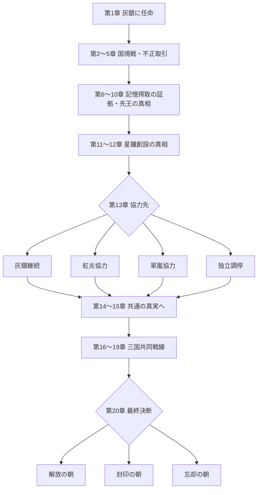

# 灰銀戦記 ― 沈黙の星鐘 ―：三国戦争・主人公・20章分岐フロー v1.0

- 作成日：2026-11-11
- 状態：**ストーリー構成の設計資料**。既存コードに存在する設定と、今後実装する分岐案を区別する。
- 対象：全20章 × 各10ステージ＝200ステージ。既存の `c01-s01` 〜 `c20-s10` というIDを維持。
- 作品名：**灰銀戦記 ― 沈黙の星鐘 ―**（ゲームの現在の正式表示）。
- 絵づくり・3Dモデル制作の引継ぎ：[`story-art-handoff-v1.md`](./story-art-handoff-v1.md) を参照。
- 現行SSOT：`src/story-chapters.js`、`src/story-cinematic.js`、`src/campaign-stage-plan.js`、`src/story-stage-manga.js`。

## 0. この資料の位置付け

### 既存実装（変更しない事実）
- 20章の章題と大筋のあらすじ、3種類のエンディング（解放／封印／忘却）。
- 20章×10ステージの通しID・順次解放と、基本ステージ種別。
- 現行は200ステージ向けの7コマ漫画ストーリーボード。第1章冒頭は「軍師が王都へ招かれ、リュシア、ガラン、イリスと出会う」順序。
- 主人公はプレイヤーが名前・性別を設定する「灰銀軍に招かれた新任軍師」。
- 町での一度きりのオープニングと、章ごとのイベント既読フラグ。
- 城や町を含む3Dマップはテンプレートを含み、200ステージそれぞれが専用完成マップという意味ではない。

### 今回追加する**設計方針**（未実装）
- 三国と記録院の外交・軍事上の関係を明文化。
- 主人公の**出自・所属・指揮権・協力先**を分けて管理。
- 第2〜12章の行動蓄積、第13章の協力ルート分岐、第14〜15章のルート固有イベント、第16章での共同戦線合流、第20章の3結末。
- 救出、探索、証拠、戦闘成績が分岐条件となる。毎回会話メニューを出す方式は避ける。
- 部隊配置、援軍、対戦勢力、イベント会話、漫画の絵が分岐結果と矛盾しないようにする。
- これらを**本資料の登録だけで実装済みとみなさない**。

## 1. 国家・勢力の定義

| 勢力ID（案） | 名称 | 政治上の統治者・代表 | 戦争に参加する理由 | 内部対立 |
|---|---|---|---|---|
| `silver` | 灰銀王国 | 摂政リュシア | 国境防衛と王国の維持 | 先王の偽造王印、王家と記録院の密約 |
| `crimson` | 紅炎帝国 | 皇帝ヴァルド | 領土・資源・皇子の記憶を取り戻す希望 | 住民優先のライゼンと強硬派グラド、宮廷のザハル |
| `verdant` | 翠嵐王国 | 女王アルテア | 星鐘の魔力を介した森・水源・民の生活の維持 | 自然の保全と死者の記憶の解放 |
| `archive` | 記録院 | 院長ヴェス | 死者の記憶の管理、星鐘の再起動を正当化 | 生活を支える魔力という名目と記憶搾取 |
| `warden` | 鐘守（歴史的組織） | エルネの残響が証人 | 星鐘の本来の誓い「本人の同意」を取り戻す | 現代国家としては行動しない |
| `neutral` | 独立の民・森守 | ノエルら | 国境を超えて土地や避難民を守る | 三国の軍事判断に左右される |

重要：この物語の敵は最初から一国に固定されない。序盤は紅炎・翠嵐が軍事的対立国でも、各国の住民や良心的な軍人と協力できる。第16章以降の主要な敵は記録院および星鐘の暴走を止めようとする者に対抗する部隊である。

## 2. 主人公の立場（ブレない定義）

1. **出発時点**：氏名・性別をプレイヤーが決める新任軍師。血統で選ばれた「予言の勇者」ではない。
2. **第1〜12章の正規所属**：灰銀王国の軍師。リュシアから任命され、ガランが導く。灰銀の国民・軍民への責任がある。
3. **指揮権**：本人が編成した軍師・傭兵・部隊を指揮。国家の全軍を初日から自由に動かせるわけではない。
4. **第13章の政治的転機**：行動と信頼実績に応じ、灰銀継続／紅炎協力／翠嵐協力／独立調停の協力ルートが開く。協力と「正式な国籍変更・亡命」は別概念。
5. **第14〜15章**：選んだルートの指揮支援を受けるが、主人公の出自や第1章の事実は変わらない。
6. **第16〜19章**：三国が別々の国家のまま軍事協調。主人公は共同作戦の軍師。各国の信頼度に応じて指揮可能な援軍が増減する。
7. **第20章**：国家を征服して君臨するのではなく、死者の記憶と生者の生活をどう両立するか、最後に本人の意思で決める「第零の記録者」。

**軍の所属、政治的協力先、戦闘中の友軍／敵軍は別フィールド**として扱う。「紅炎と協力＝灰銀の人物が自動的に敵になる」「翠嵐と協力＝旗や国王が置き換わる」とはしない。

## 3. 20人のキャラクターIDと所属

この表の `id` は `src/story-cinematic.js` の `STORY_KEY_PEOPLE` と一致させる。立場の説明は物語設計のために補足した。

| id | 氏名 | 主な関係国／勢力 | 役割と主人公との関係 |
|---|---|---|---|
| `lucia` | リュシア | 灰銀 | 摂政。軍師を招く。王印の偽造を追う |
| `garan` | ガラン | 灰銀 | 老騎士。軍師の導き手、救命を重視 |
| `iris` | イリス | 灰銀 | 治癒師。死者名簿と記録院の罪を追う |
| `shion` | シオン | 灰銀 | 忍び頭。屋根・窓・偵察・救出 |
| `kai` | カイ | 灰銀 | 盗賊・斥候。鍵、密輸、秘密資料 |
| `leon` | レオン | 灰銀／紅炎に縁故 | 傭兵隊長。紅炎に家族を残す |
| `fio` | フィオ | 灰銀 | 工兵長。橋と星鐘の金属、召喚獣研究との関わりは脚本上の整合性要調整 |
| `edo` | エド | 灰銀 | 記録官。戦死者の改竄と記憶喪失の証言 |
| `mina` | ミナ | 灰銀の避難民 | 少女。井戸に残る父の声が旅の動機 |
| `noel` | ノエル | 森守・独立／灰銀と関係 | 独立した森の保護者・使節。**既存データの所属ラベル「灰銀」と調整候補** |
| `raizen` | ライゼン | 紅炎 | 国境将軍。住民救出を優先し主人公と停戦し得る |
| `vald` | ヴァルド | 紅炎 | 皇帝。亡き皇子に執着 |
| `selika` | セリカ | 紅炎 | 皇女。父王の命令と記録院の秘密を知る |
| `zahar` | ザハル | 紅炎 | 宰相。記憶の取引・国家財政に関与 |
| `grad` | グラド | 紅炎 | 重装将軍。強硬な軍事判断から変化 |
| `altea` | アルテア | 翠嵐 | 女王。森の生命力と死者の自由に葛藤 |
| `orphe` | オルフェ | 翠嵐 | 艦隊司令。**記録院長ではない**。海底の星鐘部品を知る |
| `meve` | メーヴ | 翠嵐 | 密偵長。三国の密約を調べる |
| `elne` | エルネ | 鐘守 | 千年前の星鐘創設者の記憶の残響 |
| `vess` | ヴェス | 記録院 | 記録院長。秘密を隠す主たる対立人物 |

**脚本整合性の修正対象（今はソースを改変しない）：**
- 第7章の「召喚士フィオ」記述と既存 `fio`「工兵長」は矛盾。工兵兼召喚技術研究者に寄せるか、別の召喚士を正式追加するかを決める。
- 第6章の「若い騎士エド」記述と `edo`「記録官」を統一する（元騎士・現記録官など）。
- 第18章の「記録院総長オルフェ」は `orphe` が翠嵐艦隊司令である設定と衝突。記録院長 `vess` に統一する案を採用。
- ノエルの所属ラベルと「三国に属さない森守」の扱いを統一する。
- 最終章の「敵二国の本拠地制圧必須」は共同戦線・和平ルートと両立しない。各国の協定による終戦でも第20章へ進行できる設計に変更する必要がある。

## 4. ストーリーの主軸・大分岐



- 第13章までは**一本の背骨＋行動結果の蓄積**。
- 第13章のルートは、事前行動が条件を満たしている選択肢のみ解放。政治的方針を決める重要イベントとして扱う。
- 第14〜15章は**キャラ・援軍・戦場・一部会話**がルート別になる。
- 第16章で危機を受け**三国共同戦線へ合流**するが、前のルート履歴・親密度・救出記録・犠牲は保持。
- 第20章の結末選択は、記録・星鐘・人命の状態と本人の意思から決まる。条件未達を選べたように見せない。

## 5. 20章の進行・行動分岐（章題は既存に準拠）

| 章 | 章題 | 主人公の立場・戦い | 物語の転機 | 行動分岐・後章への影響 |
|---|---|---|---|---|
| 01 | 灰の勅命 | 灰銀軍師として着任 | 王都レヴナ、リュシア・ガラン・イリスと出会い、偽造王印と星鐘の異変を知る | 町・会話・編成のチュートリアル。初回のみイベント |
| 02 | 消えた鐘守 | 灰銀軍の平原調査 | ミナの亡父、記憶の重さを記した帳簿 | 避難民救出優先／資料確保優先。救出・証拠を記録 |
| 03 | 松影の密約 | 灰銀軍＋森守との交渉 | 森の古い記憶石、軍の近道と墓の対立 | 森を保護し迂回／伐採して進軍。翠嵐の信頼と補給に影響 |
| 04 | 罪を量る橋 | 灰銀軍として港を調査 | 灰銀が紅炎へ星鐘部品を流した証拠 | 告発／証拠保管。宮廷の反応と後の証拠公開に影響 |
| 05 | 紅の烽火 | 灰銀軍で紅炎の国境戦 | ライゼンが住民救出のため城門を開く | 避難民保護を優先／強行突破。ライゼンの信頼に影響 |
| 06 | 泣かない騎士 | 灰銀の関所防衛 | 記憶を奪われた帰還兵 | 負傷者救出／戦線保持。生存者とイリスの評価に影響 |
| 07 | 湖底の名簿 | 灰銀調査隊 | 召喚獣と人の記憶のつながり | 召喚獣の意思を尊重／軍用管理。後の召喚獣協力に影響 |
| 08 | 翠嵐の祈り | 翠嵐と国境で対峙 | 森を守る魔法が死者の記憶を使うと知る | 森を守り交渉／魔力供給拠点を破壊。女王の信頼に影響 |
| 09 | 屋根を渡る影 | 灰銀特殊部隊 | シオン・カイが封印塔へ潜入、記憶選別装置を発見 | 隠密潜入／正面制圧。証拠の完全性・損害に影響 |
| 10 | 刻まれぬ戦死者 | 灰銀軍＋紅炎穏健派の接触 | 先王が星鐘再起動に抵抗し処刑された真実 | 証拠を公表／持ち帰り精査。三国情勢が変わる |
| 11 | 血で買われた春 | 灰銀調査隊 | 記憶から消された集落と召喚獣の異変 | 生存者救助／施設の制圧。救出記録・翠嵐の信頼に影響 |
| 12 | 王都の密室 | 灰銀の特使として翠嵐へ | 星鐘が人々を救うための技術として造られた事実 | 記録を共有／灰銀へ保管。政治的協力の条件に影響 |
| 13 | 二人の女王 | 三国間の交渉役 | リュシア・アルテア会談とミナの訴え | **灰銀継続／紅炎協力／翠嵐協力／独立調停**。実績で解放 |
| 14 | 千年前の証人 | 選んだ協力ルート | エルネの残響と、本人の同意を破った歴史 | 証言公開／安全に保管。協力国と記録院警戒度に影響 |
| 15 | 第零の記録者 | 協力先の支援を受ける軍師 | 主人公は「拒否できる自由」を持つ第零の記録者 | 自己犠牲ルートを調査／別の手段を模索。最終条件に影響 |
| 16 | 黒星の夜 | 三国共同作戦の軍師 | 記録院による星鐘の強制再起動、記憶消失が拡大 | 全面共同指揮／限定協力。援軍数と指揮範囲に影響 |
| 17 | 百隊の祈り | 三国共同戦線 | 千人規模の戦いで避難路・橋・扉・民を守る | 防衛／救助の配置判断。生存者と援軍に影響 |
| 18 | 星鐘の心臓 | 共同戦線で記録院へ進軍 | 星鐘の心臓、記録院長ヴェスの主張に対峙 | 装置破壊／稼働を抑えて制圧。結末条件に影響 |
| 19 | 救済の代価 | 三国の終戦協議 | 解放・封印・記憶継承の代償が判明 | 最終作戦の準備。解放条件・支援の有無が変わる |
| 20 | 沈黙の朝 | 三国連合と最後の戦い | 星鐘の運命を主人公が決定 | **解放の朝／封印の朝／忘却の朝**の3結末 |

※ 上の行動分岐は**将来の設計案**であり、現在の `src/story-chapters.js` が実際にこの全分岐を備えているという意味ではない。

## 6. 第13章：4つの協力ルートの定義

| ルート | 指揮・外交上の位置 | 代表協力者 | 主な戦闘差分 | 解放の方向性（条件の数値は未確定） |
|---|---|---|---|---|
| 灰銀継続 | 灰銀軍所属のまま王国内部を改革 | リュシア、ガラン、イリス | 王城・国境の防衛、王家内の不正部隊との対峙 | 基本ルート、常に利用可能 |
| 紅炎協力 | 灰銀軍師の出自を保ち、紅炎穏健派と共同指揮 | ライゼン、セリカ | 紅炎強硬派の無力化、避難路確保、紅炎援軍 | 第5・10章等の救出、ライゼンの信頼 |
| 翠嵐協力 | 灰銀と翠嵐の特使・作戦協力 | アルテア、メーヴ、ノエル | 森と記録庫の保全、森の地形・精霊援軍 | 第3・8・11・12章等の保護、アルテアの信頼 |
| 独立調停 | どの国からも独立した調停軍師 | 三国の協力者 | 小規模混成兵力から共同作戦へ。資金・補給が厳しい | 三国の信頼、証拠、非戦闘員救助の実績 |

原則：
- ルート変更は「主人公の国籍変更」ではなく「政治的協力関係」と「部隊の指揮権変更」で実装する。
- すべてのルートを最終的に第16章へ合流させ、全200ステージ分の進行順を維持する。
- 共通シーンの人物名・顔・装備色を安易に差し替えない。
- ルート選択によって誰が味方かを確定し、戦闘ルールと紙芝居に同じ情報を渡す。

## 7. 3エンディングと条件

| endingId | タイトル | 決断と代償 | 事前準備の例（数値未確定） |
|---|---|---|---|
| `release` | 解放の朝 | 星鐘を解き、死者の記憶を還す。魔力供給が衰える | 記録・証人を確保、星鐘への到達 |
| `seal` | 封印の朝 | 星鐘を封じて現在の暮らしを保つ。囚われた声は残る | 星鐘制御装置の確保、三国協議 |
| `inherit` | 忘却の朝 | 主人公の記憶を代償に仕組みを変える。主人公の名は世界から消える | 第15章の真相、本人の自由な同意、装置の制御 |

重要：隠し分岐のために救出数などの**閾値を後付けで断定しない**。選択可能条件・理由・不可理由をシステムで明示し、分岐テストで保証する。

## 8. 1章10ステージの共通骨格

`src/campaign-stage-plan.js` に準拠。章ごとに話の内容や舞台・敵軍を差し替え、ステージIDの変更はしない。

| slot | 役割 | イベントの狙い |
|---|---|---|
| s01 | 町・拠点、章の導入 | 前章からの接続、人物・陣営の紹介 |
| s02 | 探索・魔物討伐 | 証人、記録、土地の異変 |
| s03 | 陣地制圧 | 軍事的な背景と補給線 |
| s04 | 探索 | 古い遺構と秘密 |
| s05 | 防衛または制圧 | 民を救う／軍を優先する葛藤 |
| s06 | 探索 | 鍵・裏道・特殊職の役割 |
| s07 | 制圧または防衛 | 敵将の事情と変化 |
| s08 | 探索 | 情報公開・交渉の決断 |
| s09 | 攻城戦 | 章決戦への布石 |
| s10 | ボス／章決戦 | 章の事件を収束、次章へ接続 |

現行と同じく奇数章・偶数章で s05／s07 の種別が入れ替わる場合がある。勝利条件は `town/explore/capture/defend/siege/boss` の既存カテゴリと対応させる。

## 9. 分岐状態・セーブ仕様の提案

セーブデータの互換性を守るため、今後は既存の `storyFlags` 以下へ追加し、未定義の旧データには安全な既定値を設定する。ここに示す名前は**まだ実装していない設計上のキー案**。

```json
{
  "storyFlags": {
    "openingEventCompleted": true,
    "chapterOpenings": {"1": true},
    "stageMangaSeen": {"c01-s01": true},
    "diplomacy": {
      "silverTrust": 0,
      "crimsonTrust": 0,
      "verdantTrust": 0,
      "civiliansRescued": 0,
      "evidenceFound": [],
      "protectedCharacters": []
    },
    "route": {
      "originalAffiliation": "silver",
      "activeCooperation": "silver",
      "coalitionFormed": false
    },
    "starbell": {
      "evidenceResolved": false,
      "coreState": "unknown",
      "endingEligibility": []
    }
  }
}
```

上記の数値ゼロは**データ構造の例**であり信頼度評価・解放閾値ではない。戦闘結果と住民救助／被害／証拠は確定したイベントだけ一度反映する。エンディング選択も一度のみ記録する。

町でのセーブ仕様を維持し、戦闘中は一時セッションに保存して、正式な戦闘結果を確定してから進行へ反映する。町への再入場でオープニングを再起動しない。タイトルからの明示的な「序章を見る」は再生しても、章クリアや報酬を重複付与しない。

## 10. 紙芝居／イベント制作ルール

1. 第1章 `c01-s01` の人物登場順は**主人公→リュシア→ガラン→イリス→偽の王印→最初の決断→町へ**。
2. 物語の理解に必要な紹介を先に出す。突然戦闘や政治の説明で始めない。
3. 各ステージの基本7コマ順は、**導入→人物会話→人物会話→手掛かり→対立→決断→次の舞台**。
4. 絵は章・人物・所属・衣装・前後関係の一貫性を維持し、立ち絵の使い回しだけで表現しない。
5. 主人公の顔は制作中の3Dモデルの仕様に合わせる。今は確定外見を捏造しない。
6. 章の世界設定と台詞が一致し、各キャラが未経験の出来事を知っているような先取りをしない。
7. 同じ事件が町の往復で繰り返されない。既読判定と明示的再生を区別する。
8. BGMは章・出来事・緊張感に合わせ、軽快なアーケード調は避ける。
9. 生成絵の差し替えは段階的に行い、完成したキャラ原画とキーアートを優先して同一人物の見た目を固定する。

## 11. 開発・QAの受入条件（設計段階）

- 20章の章題、200個の既存ステージID、各10ステージ構造を変えない。
- 全20人のキャラID・陣営・役割が台詞と絵のタグで一致。
- 第13章の4ルート分岐後も全ルートが第16章に到達できる。
- 同一セーブ・同一フラグから同じイベント／援軍が再現可能。
- 各ルートで味方が敵に誤って配置されない。
- 町再訪による初回イベント再生なし。既読フラグはセーブ後も保持。
- 第20章は**征服だけを必要条件にしない**。外交・和平を含む正当な終戦方法に対応。
- 3エンディングの条件表示・同意・帰結が矛盾しない。
- 既存の50対50・1000対1000戦闘、町3D、カメラ・当たり判定・音声に回帰影響を与えない。
- 画像納品時は各素材を人物ID・章・コマIDで参照できる（別資料参照）。

## 12. 実装順の提案

1. 人物・国・所属の不整合をSSOTで整理する（フィオ、エド、ノエル、オルフェ／ヴェス）。
2. 第1章の漫画と主要人物の高品質イラストを完成させ、登場順と初回のみ再生を固定する。
3. 20章のキーアートとキャラ立ち絵の継続性を確保。
4. 行動結果、外交信頼、証拠を保存するフラグ層を実装。
5. 第13〜15章の協力ルートと第16章の合流・援軍を実装。
6. 最終章の到達条件を征服以外にも拡張し、3エンディングを接続。
7. ステージ別分岐演出、戦闘結果連携、200ステージの回帰テストを拡張。

**注意**：本コミットは文章のみ。現在進行中の画像生成・3Dモデル・ゲーム本体のソースは変更しない。
